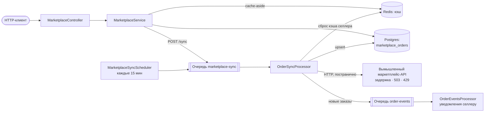
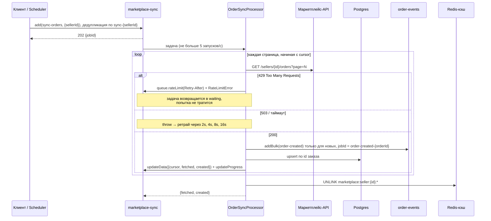
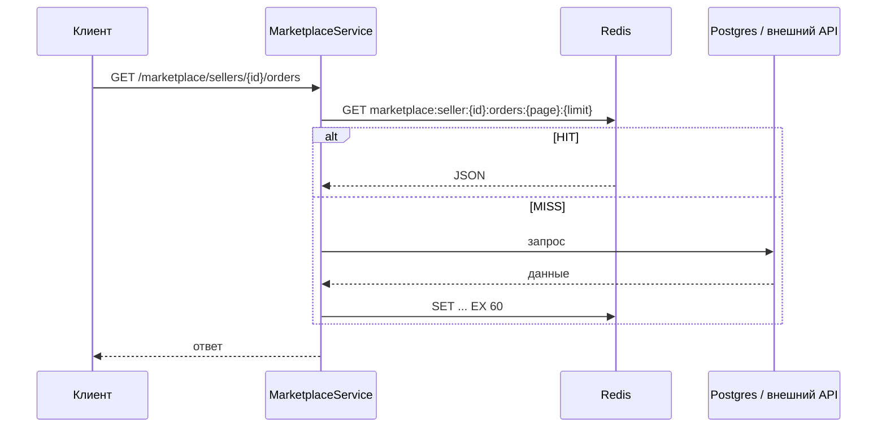

# Redis: очереди и кэш на примере синхронизации с маркетплейсом

Модуль `marketplace` забирает заказы селлеров из внешнего API в фоне через очереди BullMQ, складывает их в Postgres и отдаёт чтения через кэш в Redis. Внешний API вымышленный (`fake-marketplace`), но ведёт себя как настоящий: отвечает с задержкой, иногда падает с 503 и режет частые запросы ответом 429.

## Запуск

```bash
docker compose up -d redis   # Redis 8 с AOF
# Postgres: локальный (порт из .env) или docker compose up -d db
npm run start:dev
```

| Переменная | По умолчанию | Что задаёт |
| --- | --- | --- |
| `REDIS_HOST`, `REDIS_PORT` | `localhost`, `6379` | Redis для кэша и очередей |
| `MARKETPLACE_API_URL` | `http://localhost:${PORT}/fake-marketplace` | Базовый URL внешнего API |
| `MARKETPLACE_SYNC_SELLERS` | `seller-1,seller-2` | Селлеры для синка по расписанию |
| `MARKETPLACE_SYNC_EVERY_MS` | `900000` (15 мин) | Интервал синка по расписанию |
| `FAKE_MARKETPLACE_FAILURE_RATE` | `0.1` | Доля ответов 503 у вымышленного API |

## Архитектура



Две очереди разделяют работу разной природы. `marketplace-sync` ходит во внешний API и упирается в его лимиты, поэтому работает с низкой конкурентностью (2) и лимитом запусков. `order-events` обрабатывает каждый новый заказ отдельно (уведомления) с конкурентностью 10 и не тормозит синк.

## Флоу 1: синхронизация заказов



1. Синк запускается вручную (`POST /marketplace/sellers/:sellerId/sync`) или по расписанию (`upsertJobScheduler`). Ответ сразу `202` с `jobId`: тяжёлая работа не держит HTTP-запрос.
2. Повторный POST, пока синк селлера ждёт или выполняется, возвращает тот же `jobId` (`deduplication`).
3. Воркер идёт по страницам. После каждой страницы сохраняет чекпоинт (`cursor` и счётчики) в данные задачи. Любой ретрай продолжает с последней страницы, а не с первой.
4. Для новых заказов ставятся события в `order-events`. Они ставятся до записи в БД: если процесс упадёт между шагами, ретрай поставит их снова, а одинаковый `jobId` не даст дубля.
5. Заказы пишутся через `upsert` по id из маркетплейса: повторный синк обновляет статусы и не создаёт дублей.
6. В конце сбрасывается весь кэш селлера, и следующие чтения получат свежие данные.

## Флоу 2: чтение через кэш (cache-aside)



Кэш — оптимизация, а не источник правды: если Redis недоступен, `RedisCacheService` пишет warning и отдаёт данные из источника. Ответы внешнего API (`/products/:asin`) кэшируются на 10 минут: повторные запросы приходят за ~3 мс вместо ~400 мс и не тратят лимит API.

## Ключи Redis

| Ключ | TTL | Когда сбрасывается |
| --- | --- | --- |
| `marketplace:seller:{id}:orders:{page}:{limit}` | 60 с | После синка селлера (по префиксу) |
| `marketplace:seller:{id}:stats` | 5 мин | После синка селлера (по префиксу) |
| `marketplace:product:{asin}` | 10 мин | Только по TTL |
| `bull:marketplace-sync:*`, `bull:order-events:*` | — | Служебные ключи BullMQ |

Сброс по префиксу идёт через `SCAN` + `UNLINK`, а не `KEYS` + `DEL`, чтобы не блокировать Redis на большом количестве ключей.

## Обработка сбоев

| Ситуация | Что происходит |
| --- | --- |
| 503, таймаут, сеть | Ретрай с exponential backoff: 5 попыток, паузы 2–16 с. Продолжение с чекпоинта |
| Все 5 попыток неудачны | Задача остаётся в `failed` на 7 дней для разбора (аналог dead letter queue) |
| 429 от API | `queue.rateLimit(Retry-After)` ставит на паузу всю очередь, `RateLimitError` возвращает задачу в `waiting` без траты попытки |
| Повторный запуск синка того же селлера | `deduplication` возвращает уже существующий `jobId` |
| Повторный синк тех же данных | `upsert` по id заказа, события только для новых заказов |
| Redis для кэша недоступен | Чтения идут напрямую в источник, в лог пишется warning |
| Рестарт приложения или Redis | Задачи и расписание лежат в Redis с AOF и переживают рестарт. Scheduler обновляется через идемпотентный `upsertJobScheduler` |

## API

```bash
# запустить синк (202, jobId)
curl -X POST localhost:3000/marketplace/sellers/seller-3/sync

# статус задачи: state, progress, attemptsMade, result
curl localhost:3000/marketplace/sync/5

# заказы и статистика (через кэш)
curl "localhost:3000/marketplace/sellers/seller-3/orders?page=1&limit=20"
curl localhost:3000/marketplace/sellers/seller-3/stats

# товар из внешнего API (через кэш)
curl localhost:3000/marketplace/products/B0FAKE0003
```

Смотреть ключи и очереди в Redis:

```bash
docker compose exec redis redis-cli --scan --pattern 'marketplace:*'
docker compose exec redis redis-cli TTL marketplace:product:B0FAKE0003
docker compose exec redis redis-cli LLEN bull:marketplace-sync:wait
```

## Где что лежит

| Файл | Роль |
| --- | --- |
| `src/redis/redis.module.ts`, `redis-cache.service.ts` | Клиент ioredis, cache-aside и сброс по префиксу |
| `src/fake-marketplace/` | Вымышленный внешний API: задержка, 503, лимит 5 запросов/с |
| `src/marketplace/marketplace.client.ts` | HTTP-клиент, ошибки `MarketplaceRateLimitError` и `MarketplaceApiError` |
| `src/marketplace/marketplace.module.ts` | Регистрация очередей и их ретрай-политики |
| `src/marketplace/processors/order-sync.processor.ts` | Синк: страницы, чекпоинты, 429, upsert, события, сброс кэша |
| `src/marketplace/processors/order-events.processor.ts` | Обработка событий о новых заказах |
| `src/marketplace/marketplace-sync.scheduler.ts` | Синк по расписанию |
| `src/marketplace/marketplace.service.ts` | Запуск синка, статус задачи, чтения через кэш |
